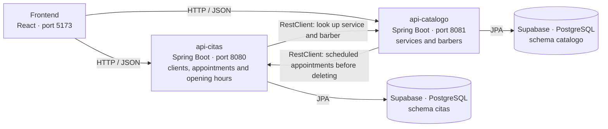
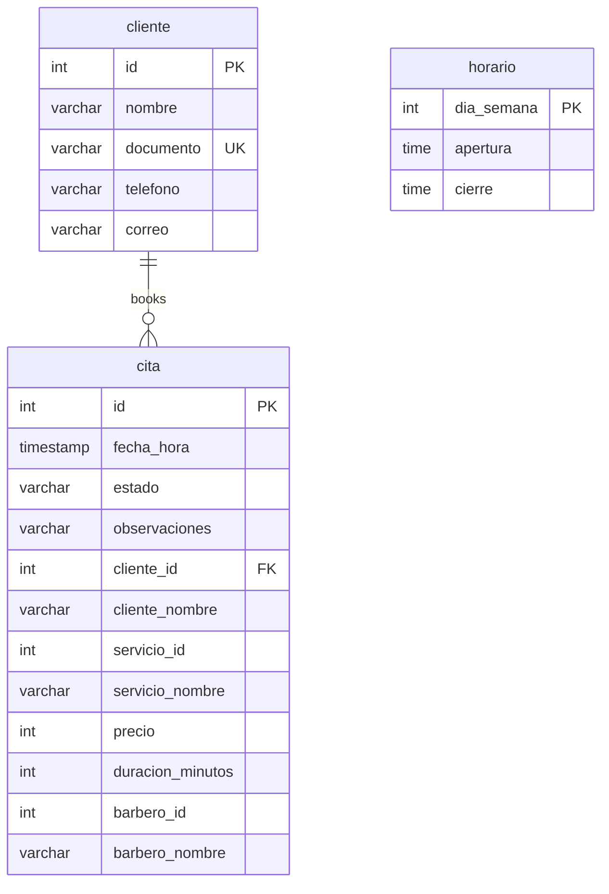

# Barbershop management system

Second-term project for **Solution Design** — Systems Engineering.
Group 8: Daniel Felipe Vanegas and Camilo Andrés Paternina.

The barbershop books appointments: each appointment joins a client, a service and a barber.
We split the system into two Spring Boot microservices and a web interface that consumes them.

## Architecture



| Part | Folder | What it does |
|---|---|---|
| api-catalogo | `api-catalogo/` | CRUD for the services the barbershop offers and for the barbers. |
| api-citas | `api-citas/` | CRUD for clients and appointments, and the opening hours. To book, it looks up the service and the barber in api-catalogo. |
| Frontend | `frontend/` | Web interface to manage the four entities and see the status of the microservices. |

Each microservice runs separately, has its own controllers and stores its own data.

### Database

The data lives in a PostgreSQL database on Supabase. Each microservice owns one schema and
never reads the other's tables: `catalogo` has `servicio` and `barbero`, and `citas` has
`cliente`, `cita` and `horario`. They talk to the database with Spring Data JPA.



- `cita` has no foreign key to `servicio` or `barbero` because they belong to the other
  microservice. It keeps their IDs and a copy of the name, price and duration they had when
  it was booked.
- If a client is deleted, their past appointments keep the client's name (`cliente_id`
  becomes `null`).
- `horario` has one row per weekday (1 = Monday, 7 = Sunday). A day without opening and
  closing time is a day the barbershop is closed.

Each microservice creates its tables when it starts (`src/main/resources/schema.sql`) and
loads the demo data only if they are empty (`data.sql`). Both files are plain SQL, so the
schema can also be read or run from Supabase's SQL editor.

### Communication between microservices

To book an appointment the client sends only the IDs:

```json
{ "clienteId": 1, "servicioId": 3, "barberoId": 1, "fechaHora": "2026-12-01T10:00" }
```

1. `CitaController` receives the `POST /api/citas`.
2. `CitaService` looks up the client, which belongs to api-citas.
3. `CatalogoCliente` sends `GET /api/servicios/{id}` and `GET /api/barberos/{id}` to api-catalogo with `RestClient`.
4. With the three responses the appointment is checked against the opening hours and the
   other appointments, saved and answered with `201`.

The communication is synchronous: api-citas waits for api-catalogo's response before
continuing. If api-catalogo is down, api-citas answers `503` with a clear message and the
rest of its endpoints (clients, querying appointments) keep working.

It also goes the other way: before deleting a service or a barber, `CitasCliente` in
api-catalogo asks api-citas for its scheduled appointments
(`GET /api/citas?barberoId={id}&estado=PROGRAMADA`). If there are any, the delete is
rejected with `409`; if api-citas is down, with `503`.

Each microservice has the other's URL in `application.properties` (`api.catalogo.url` and
`api.citas.url`), not in the code.

## How to run

Requirements: **JDK 17 or later**, **Node.js 20 or later** and a **Supabase** project
(the free plan is enough). Maven is not needed: each microservice ships its own wrapper
(`mvnw`).

**0. Database**

1. In Supabase, create a project and keep its database password.
2. Open **Connect** and copy the **Session pooler** connection (port 5432). It works on IPv4
   networks; the direct connection only works on IPv6.
3. Copy `.env.example` to `.env` at the repository root and fill in `DB_URL`, `DB_USER` and
   `DB_PASSWORD`. Both microservices read that file. `.env` is ignored by git.

The tables and the demo data are created the first time each microservice starts. On the
free plan Supabase pauses a project after a week without use; it is resumed from the
dashboard.

Open three terminals at the repository root.

**1. api-catalogo** (port 8081)

```bash
cd api-catalogo
./mvnw spring-boot:run
```

**2. api-citas** (port 8080)

```bash
cd api-citas
./mvnw spring-boot:run
```

**3. Frontend** (port 5173)

```bash
cd frontend
npm install
npm run dev
```

On Windows (PowerShell or CMD) the wrapper is called `.\mvnw.cmd`.

| Address | What is there |
|---|---|
| http://localhost:5173 | Web interface |
| http://localhost:8081/swagger-ui.html | Swagger for api-catalogo |
| http://localhost:8080/swagger-ui.html | Swagger for api-citas |

The frontend has to run on port 5173 because it is the only origin the microservices
accept through CORS (`frontend.url` in each `application.properties`).

## REST API

The full table of endpoints per controller is in
[docs/endpoints.pdf](docs/endpoints.pdf) (also in Word: `docs/endpoints.docx`).

The four resources follow the same scheme:

| Method | Endpoint | Operation |
|---|---|---|
| `POST` | `/api/{resource}` | Create |
| `GET` | `/api/{resource}` | List |
| `GET` | `/api/{resource}/{id}` | Get one |
| `PUT` | `/api/{resource}/{id}` | Update |
| `DELETE` | `/api/{resource}/{id}` | Delete |

`{resource}` is `servicios` or `barberos` in api-catalogo, and `clientes` or `citas` in
api-citas. In addition:

- `GET /api/citas` accepts optional filters: `clienteId`, `barberoId`, `servicioId`,
  `estado` and `fecha` (`2026-10-20`).
- `PATCH /api/citas/{id}/estado` changes only an appointment's status (complete or cancel).
- `GET /api/horario` returns the opening hours of the seven weekdays, and
  `PUT /api/horario/{diaSemana}` changes one day (`{"apertura": "09:00", "cierre": "19:00"}`,
  or both `null` to close it).
- `GET /api/conexion/catalogo` checks, from api-citas, that api-catalogo responds.
- `GET /api/status` on each microservice.

Errors always arrive as `{"mensaje": "..."}` with the matching code: `400` invalid data,
`404` not found, `409` conflicts with the current data, `503` the other microservice did
not respond.

### JSON and XML

The services' `GET` endpoints return JSON or XML depending on the `Accept` header:

```bash
curl -H "Accept: application/xml" http://localhost:8081/api/servicios/1
```

```xml
<ServicioDTOResponse><id>1</id><nombre>Corte clásico</nombre>...</ServicioDTOResponse>
```

## Business rules

- An appointment is only booked with a service and a barber that are **active** in the catalog.
- Appointments are not booked on a past date.
- An appointment has to start and end within the **opening hours** of its day: Monday to
  Saturday from 9:00 to 19:00, closed on Sunday (the demo data; they are changed with
  `PUT /api/horario/{diaSemana}`). The hours cannot change if a scheduled appointment would
  fall outside them.
- Neither a barber nor a client can have two scheduled appointments that overlap. The
  overlap is computed with the service's duration.
- An appointment starts as `PROGRAMADA` (scheduled) and can only move to `COMPLETADA`
  (completed) or `CANCELADA` (cancelled). It can only be completed once its time has come.
  Once closed it is not modified.
- The appointment keeps the service's name, price and duration it was booked with. Editing
  it with the same service keeps them, even if the service later changed or was deactivated.
- A client with scheduled appointments is not deleted. When a client is deleted, their past
  appointments keep the client's name.
- A service or a barber with scheduled appointments is not deleted; it can be deactivated
  instead, so it gets no new bookings.
- Client and barber ID documents and service names are not repeated. Phone numbers, when
  given, have 7 to 10 digits.

## Structure of each microservice

```
controller/   REST endpoints and the error handler
service/      business rules
repository/   database access with Spring Data JPA
model/        domain entities (JPA entities)
dto/          what the API receives (DTORequest) and what it returns (DTOResponse)
cliente/      communication with the other microservice
config/       RestClient and CORS
resources/    application.properties, schema.sql and data.sql
```

## What we applied from each class

| Topic | Where it is |
|---|---|
| Microservices | Two independent Spring Boot applications, each with its own port and data. |
| API First | We designed the resources and endpoints first (`docs/endpoints.pdf`). Swagger UI documents each API. |
| Layered architecture | `Controller → Service → Model` in both microservices. |
| HTTP methods | `GET`, `POST`, `PUT`, `PATCH` and `DELETE`, with their response codes. |
| JSON, Jackson and DTOs | One `DTORequest` and one `DTOResponse` per resource. The client never sends the `id` or an appointment's status: the application sets them. |
| XML | `jackson-dataformat-xml` and `produces` with JSON and XML in `ServicioController`. |
| Synchronous communication | `CatalogoCliente` in api-citas and `CitasCliente` in api-catalogo, each with its `RestClientConfig`. |
| Persistence | Spring Data JPA repositories over PostgreSQL (Supabase), one schema per microservice. |

We use Spring Boot 4, which ships Jackson 3. That is why the XML dependency is
`tools.jackson.dataformat:jackson-dataformat-xml` and not the `com.fasterxml` one from Jackson 2.

## Interface

Built with React and Vite, with no component library: the styles are plain CSS in
`frontend/src/estilos/` (base, estructura, componentes and citas). The barbershop is called
El Remolino.

- Sidebar with the five sections: Hoy (today), Citas (appointments), Clientes (clients),
  Servicios (services) and Barberos (barbers). The open section is kept in the address
  (`#/citas`), so F5 and the back button preserve it.
- Hoy is the day's schedule: one column per active barber and the opening hours going
  down. Clicking a free slot books that time with that barber. On a closed day it says so.
  Next to it are the next appointment with its actions, the day's totals and the upcoming
  appointments.
- Citas shows each appointment as a ticket, grouped by day, with a search and a status
  filter. Clientes, Servicios and Barberos have a table, a search, a form to create and
  edit, and a confirmation before deleting.
- The appointment form shows the opening hours and what the barber already has booked that
  day, and warns about an overlap or a time outside the opening hours before saving. It
  also lets you create a client without leaving it.
- The Complete button only appears once the appointment's time has come.
- The forms validate before submitting and show the API's message when it rejects the
  operation. Confirmations show the data of the appointment or record.
- The status of both microservices and of the call between them is visible in every
  section, at the bottom of the sidebar. If api-catalogo does not respond, the interface
  explains it, shows the 503 response from api-citas and recovers on its own when it
  comes back.
- While the data arrives, skeletons shaped like the content are shown.
- Light and dark theme. The choice is remembered and, the first time, the system's is used.
- It adapts to small screens (bottom menu and rows as cards) and respects the
  reduced-motion preference.

## Tests

```bash
cd api-catalogo && ./mvnw test
cd api-citas && ./mvnw test
```

There are 54 tests with JUnit and MockMvc. They do not touch Supabase: each test starts with
its own in-memory H2 database in PostgreSQL mode, built with the same `schema.sql` and
`data.sql` (`src/test/resources/application-test.properties`). The other microservice is
replaced with a Mockito double (`CatalogoCliente` in api-citas, `CitasCliente` in
api-catalogo), so the rules and the case where it is down are tested without starting it.

## Scope

- There is no authentication. The endpoints are open and CORS only accepts the frontend's
  origin. Security with JWT is for the third term.
- The opening hours are per weekday; public holidays are not modeled yet.
